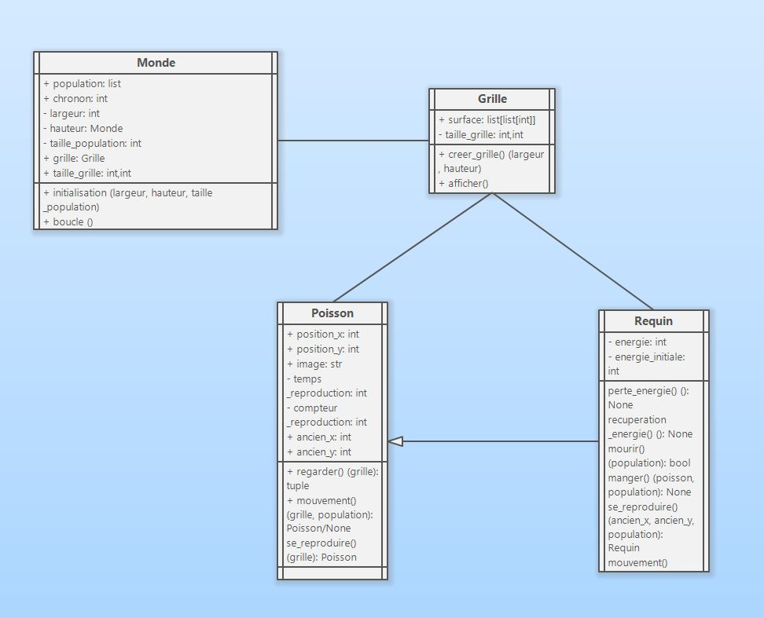

# 🐟🦈 Wa-Tor — Simulation proies / prédateurs

> _Phrase d'accroche : une ligne résumant le projet._

  

<!-- Optionnel : capture ou GIF de la simulation -->
<!--  -->

---

## 📖 Présentation

Wa-Tor est une simulation proies-prédateurs imaginée par A. K. Dewdney (1984). Des poissons et des requins évoluent sur une planète torique : les bords de la grille se rejoignent.

_[1 à 2 phrases : cadre du projet (formation, module) et objectif.]_

---

## 📜 Règles de la simulation

Le temps avance par **chronons**. À chaque chronon, chaque entité joue une fois.

| Entité | Déplacement | Reproduction | Mort |
|---|---|---|---|
| 🐟 Poisson | Case libre adjacente au hasard | Après 3 chronons | Mangé par un requin |
| 🦈 Requin | Priorité à une case contenant un poisson, sinon case libre | Après 10 chronons | Énergie à 0 (−1 par chronon, retour à 3 par poisson mangé) |

---

## 🚀 Installation

**Prérequis :** Python _[3.X]_

```bash
git clone https://github.com/Fodba/wa_tor.git
cd wa_tor
python -m venv .venv
source .venv/bin/activate      # Windows : .venv\Scripts\activate
pip install -r requirements.txt
```

---

## ▶️ Utilisation

```bash
python main.py
```

### Paramètres

_[Où les modifier : fichier de config, arguments en ligne de commande, constantes.]_

| Paramètre | Description | Valeur par défaut |
|---|---|---|
| _[largeur / hauteur]_ | Dimensions de la grille | _[…]_ |
| _[TAILLE_POPULATION]_ | Population initiale de poissons et de requins | _[…]_ |
| _[nb_requins]_ | Population initiale de requins | _[…]_ |
| _[temps_de_reproduction]_ | Chronons avant reproduction d'un poisson | _[…]_ |
| _[energie]_ | Énergie initiale d'un requin | _[…]_ |

---

## 🧩 Architecture

```
wator/
├── classes/
│   ├── __init__.py
│   ├── _[grille.py]_
│   ├── _[poisson.py]_
│   ├── _[requin.py]_
│   └── _[monde.py]_
├── docs/
│   └── _[diagramme_classes.png]_
├── main.py
├── requirements.txt
└── README.md
```

| Classe | Rôle |
|---|---|
| `Grille` | Grille torique, accès aux cases voisines |
| `Poisson` | Classe parente, comportement des proies |
| `Requin` | Comportement des prédateurs |
| `Monde` | Boucle des chronons, statistiques |

Diagramme de classes : 

---

## ✅ Tests

Les tests ont été réalisés de façon manuelle d'abord pour le développement des comportements et la boucle de simulation.
Puis pour trouver les paramètres de stabilité de la simulation.

---

## 🛠️ Technologies

- Python _[3.X]_
- termcolor

---

## 👥 Équipe

| Nom | GitHub |
|---|---|
| Mauro FADIKA | @fodba |
| Benjamin DOCHEZ | @Hoyrax |
| Kateryna VORONINA | @mail4kkate-droid |

---
